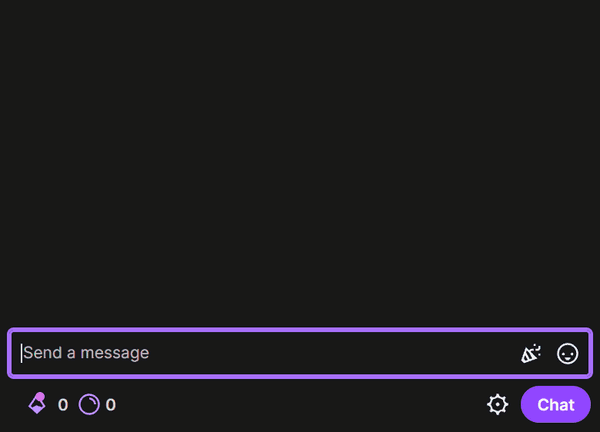

# TTS Autocomplete

A browser extension that adds autocomplete for the `!tts` command to Twitch chat. The command is for the TTS API at [nice.gg/tts](https://nice.gg/tts), so the extension is only useful in channels that use it. It is built for Chrome, Brave and Firefox. So far it was tested only in Chromium.

When you type a message that starts with `!tts`, a list of suggestions opens above the chat box. It suggests voices, sound effects and modifiers. When you type a modifier such as `-r`, it shows the valid values. If a value is out of range, for example `-r11`, it shows a warning.

  

This project is not affiliated with or endorsed by Twitch. It uses the [MIT license](LICENSE).

## Keys

| Key                | What it does                                                                   |
| ------------------ | ------------------------------------------------------------------------------ |
| Tab                | Accepts the highlighted suggestion.                                            |
| Up and Down arrows | Move through the suggestions.                                                  |
| Enter              | Accepts a suggestion after you use the arrows. Otherwise it sends the message. |
| Escape             | Closes the list until you change the message.                                  |

Voices appear after you type two letters of a word, so ordinary words do not open the list. The extension adds a space after a complete word, such as a sound or a voice. After a modifier that needs a value, such as `-r`, it puts the cursor directly after the modifier so that you can type the value.

When no suggestion matches, the extension does not use Tab. Tab then goes to your emote extension as usual. The extension was tested with BetterTTV, FrankerFaceZ and 7TV.

The extension downloads the current voice and sound names from nice.gg once a day. It does not send your messages or any information about your Twitch account. Until the first download succeeds, it completes only modifiers.

## Install

The extension is not in the Chrome Web Store or on addons.mozilla.org yet. You can download a built version, or build it yourself.

### Download a release

1. Open the [Releases page](https://github.com/mjfwebb/tts-autocomplete/releases).
2. Download `tts-autocomplete-<version>-chrome.zip` for Chrome and Brave, or `tts-autocomplete-<version>-firefox.zip` for Firefox.
3. For Chrome and Brave, unzip the file into a folder that you keep. The browser loads the extension from that folder every time it starts.

### Build it yourself

1. Install [Node.js](https://nodejs.org/) 24 and [pnpm](https://pnpm.io/) 10.
2. Clone this repository with `git clone https://github.com/mjfwebb/tts-autocomplete.git`.
3. In the `tts-autocomplete` folder, run `pnpm install`.
4. Run `pnpm build` for Chrome and Brave, or `pnpm build:firefox` for Firefox.

### Load it in Chrome or Brave

1. Open `chrome://extensions` in Chrome, or `brave://extensions` in Brave.
2. Turn on Developer mode.
3. Click Load unpacked.
4. Select the folder that you unzipped. If you built the extension, select the `.output/chrome-mv3` folder.

### Load it in Firefox

1. Open `about:debugging#/runtime/this-firefox`.
2. Click Load Temporary Add-on.
3. Select the downloaded zip file. If you built the extension, select the file `.output/firefox-mv2/manifest.json`.

If you close Firefox, it removes the temporary add-on. A permanent install needs a version signed by addons.mozilla.org.

## Development

To build, test or change the extension, see [DEVELOPMENT.md](DEVELOPMENT.md).
